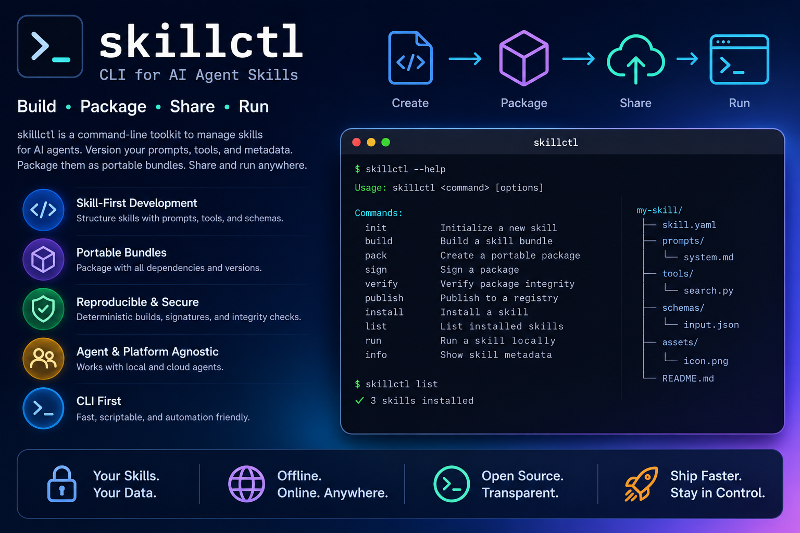

<div align="center">

# m3c-tools

Sprachen / Languages: [Deutsch](README.de.md) | [English](README.md)

### Gib deinen Agenten ein Gedächtnis und einen Nachweis ihrer Befugnisse.

**Multi-Modal-Memory Tools** ist ein persönlicher, souveräner Werkzeugkasten: Was du siehst,
hörst und entscheidest, wird zu dauerhaftem, strukturiertem Wissen. Die darauf zugreifenden
Agenten-Skills werden kontrolliert. Zwei Kommandozeilenwerkzeuge übernehmen diese Aufgaben;
ein drittes verwaltet die gemeinsam verwendeten Dienstgeheimnisse. Ein Repository ohne
verpflichtenden Cloud-Vermittler.

[](https://github.com/kamir/m3c-tools/actions/workflows/ci.yml)
[](https://github.com/kamir/m3c-tools/releases/latest)
[](README.md#install)
[](https://go.dev)
[](https://goreportcard.com/report/github.com/kamir/m3c-tools)
[](https://slsa.dev)
[](LICENSE)

[Schnellstart: m3c-tools](docs/v2/nutzer/quickstart-m3c-tools.de.md) ·
[Schnellstart: skillctl](docs/v2/nutzer/quickstart-skillctl.de.md) ·
[Vollständige Handbücher](#-dokumentation) ·
[Website](https://kamir.github.io/m3c-tools)

<br>



</div>

---

## Warum es diese Werkzeuge gibt

Autonome Agenten brauchen zwei Dinge, die es nicht fertig zu kaufen gibt:

1. **Ein Gedächtnis dessen, was tatsächlich passiert ist**: strukturierte, multimodale,
   erneut abspielbare Beobachtungen auf Infrastruktur unter deiner Kontrolle statt eines Chatprotokolls.
2. **Einen Nachweis ihrer Befugnisse.** Jeder ausgeführte Skill sollte eine überprüfbare
   Identität haben, jederzeit widerrufbar und **offline** prüfbar sein, ohne externe
   Instanz im Prüfpfad.

Dieses Repository liefert für jede Aufgabe ein eigenes Werkzeug und ein drittes für die
Zugangsdaten, auf denen beide aufbauen.

| Werkzeug | Kurzbeschreibung | Aufgabe |
|------|---------------|----------------|
| **`m3c-tools`** | *Die Erfassungspipeline.* | YouTube-Videos, Audio, Screenshots und Sprachnotizen als multimodales Wissen auf dem eigenen [ER1](https://er1.io)-Wissensserver erfassen. |
| **`skillctl`** | *Die Befugnisebene.* | Agenten-Skills signieren, zulassen, prüfen und widerrufen, damit ihr Zugriff auf Wissen und ihre Aktionen autorisiert und nachweisbar sind. |
| **`secretctl`** | *Das Geheimnisregister.* | Alle Speicherorte eines gemeinsamen Dienstgeheimnisses benennen, deren Aktualität prüfen und nachweisen, dass der alte Wert nicht mehr akzeptiert wird. Werte werden nie ausgegeben. |

`m3c-tools` füllt das Gedächtnis, `skillctl` kontrolliert die Aktionen, `secretctl` erfasst die
zugrunde liegenden Zugangsdaten. Gemeinsam bilden sie die persönliche Grundlage für
vertrauenswürdig betriebene Agenten in Produktion.

---

## Einstieg in 60 Sekunden

Wähle das passende Werkzeug. Alle drei stehen als einzelne statische Binärdateien in jedem
[Release](https://github.com/kamir/m3c-tools/releases/latest) bereit. Alternativ kannst du sie
[aus dem Quellcode bauen](#aus-dem-quellcode-bauen).

### `m3c-tools`: die erste Erinnerung erfassen

```bash
# macOS (Apple Silicon): see Install below for Intel / Linux / Windows
curl -sL https://github.com/kamir/m3c-tools/releases/latest/download/m3c-tools-darwin-arm64.tar.gz | tar xz \
  && sudo mv m3c-tools-darwin-arm64 /usr/local/bin/m3c-tools

m3c-tools setup                         # guided onboarding (ER1 URL, login, key)
m3c-tools transcript dQw4w9WgXcQ        # fetch a YouTube transcript, right now
m3c-tools doctor                        # verify connectivity & config
```

→ **Vollständige Anleitung:** [Schnellstart: m3c-tools](docs/v2/nutzer/quickstart-m3c-tools.de.md)

### `skillctl`: den ersten Skill signieren und prüfen

```bash
# macOS / Linux / Windows, signed installer: fetches the right binary from the
# signed skillctl/v* release and verifies cosign/OIDC provenance + SHA-256 first.
curl -fsSL https://raw.githubusercontent.com/kamir/m3c-tools/6f517440e7edf64c74f0f625a46291769d086f98/tools/skillctl-install.sh | bash

skillctl keygen --out ~/.config/m3c/skill-keys/mykey            # ed25519 → mykey.priv + mykey.pub
skillctl pack --skill ./my-skill -o my-skill.skb --name my-skill --version 1.0.0
skillctl sign --key ~/.config/m3c/skill-keys/mykey.priv my-skill.skb
skillctl verify-sig --pubkey ~/.config/m3c/skill-keys/mykey.pub my-skill.skb   # offline, no server
```

→ **Vollständige Anleitung:** [Schnellstart: skillctl](docs/v2/nutzer/quickstart-skillctl.de.md)

---

## Was `m3c-tools` erfasst

Vier Erfassungskanäle nutzen dieselbe Pipeline:

```
Capture → Preview + Record → Whisper transcribe → Tag editor → Store to ER1
```

| Kanal | Auslöser | Erfasste Inhalte |
|---------|---------|------------------|
| **A: YouTube** | Video-URL oder ID einfügen | Transkript, Vorschaubild und eigener Sprachkommentar |
| **B: Screenshot** | Menüeintrag | Screenshot und Sprachnotiz; vorhandenes Zwischenablagebild wird verwendet |
| **C: Impulse** | Menüeintrag | Interaktive Bereichsaufnahme und kurze Sprachnotiz |
| **D: Audio Import** | Menüeintrag / CLI | Audiodateien aus einem Ordner im Stapel, etwa von einem Rekorder oder Plaud/Pocket-Sync |

Jede Beobachtung wird zu einem multimodalen ER1-Dokument aus Text, Audio und Bild mit Tags und
Metadaten. macOS bietet eine native Menüleisten-App; Linux und Windows die vollständige CLI.
Auch ohne Transkript, etwa bei deaktivierten Untertiteln, bleiben Vorschaubild und Quelllink
einer YouTube-Erfassung erhalten. Die Beobachtung wird trotzdem abgelegt.

**Außendienstaufnahmen am tatsächlichen Zeitpunkt.** `m3c-tools plaud` überträgt Plaud.ai-Aufnahmen,
Kundenbesuche, Besprechungen und Feldnotizen direkt nach ER1. `m3c-tools pocket` übernimmt diese
Aufgabe für Pocket-Geräte. Synchronisierte Einträge liegen am **echten Aufnahmezeitpunkt** statt
am Zeitpunkt der Synchronisierung; `plaud fix-times` korrigiert frühere Importe nachträglich.
Aufnahmen verschiedener Geräte erscheinen damit an der tatsächlichen Stelle der Zeitachse.
Auf **macOS** verwendet `plaud dev` das offizielle, automatisch erneuerte OAuth-Token ohne
tägliche Neuanmeldung. Audio ohne Transkript wird standardmäßig **serverseitig** transkribiert:
siehe [Plaud-Befehlsreferenz](docs/v2/referenz/manual-m3c-tools.md#plaud-plaud-recorder-integration).

**Befehle:** `transcript`, `upload`, `whisper`, `thumbnail`, `record`, `screenshot`, `import-audio`
für Erfassung; `plaud` (`list` · `check` · `sync` · `fix-times` · `auth`; unter macOS
`dev list/sync/status`) und `pocket` für Rekordersynchronisierung; `retry`, `cancel`, `schedule`,
`status` für die ER1-Warteschlange; `doctor`, `check-er1`, `config` einschließlich `doctor`,
`settings`, `token`, `devices`, `login`, `setup`, `menubar` für Einrichtung und Diagnose.
Siehe [m3c-tools-Handbuch](docs/v2/referenz/manual-m3c-tools.de.md).

## Was `skillctl` kontrolliert

`skillctl` ist die CLI für Vertrauen und Governance bei Agenten-Skills. Der vollständige
Lebenszyklus ermöglicht die Vertrauensprüfung von Anfang bis Ende:

```
author → pack → sign → admit → attest → verify / install → use → audit → revoke
```

- **Offline prüfbar.** Die Vertrauenskette benötigt keine gehostete CA im Prüfpfad.
- **Jederzeit widerrufbar.** Signierte Offline-Widerrufslisten, Aktualitätsverträge und Ablehnung im Fehlerfall.
- **Nachweisbare Agentenidentität.** `agentid` erstellt vom Eigentümer signierte, offline prüfbare Mandate.
- **Prüfbar protokolliert.** Lokales Transparenzprotokoll (`translog`) und ein bei Fehlern sperrendes
  Claude-Code-Vertrauenstor (`verify-hook`).
- **Auch Agenten sind Bundles.** Das Manifest deklariert `kind`. `publish --kind agent` liefert
  einen Agenten aus, das Registry verwendet `art:name` als Namensraum und `pull --kind` verhindert,
  dass ein Agentenlauf benachbarte Skills überschreibt. Ohne `kind` wird weiterhin ein Skill
  angenommen; bestehende Bundles funktionieren weiter.

### Der Rechner unter dem Agenten: `skillctl trust-freeze`

Ein signierter Skill beschreibt die Befugnisse des Agenten, aber nicht seinen Rechner.
`trust-freeze` erfasst den Hostzustand, lässt ihn einmal freigeben und zeigt danach Änderungen.

```bash
skillctl trust-freeze doctor                              # what could be collected here
skillctl trust-freeze capture --profile ubuntu-bastion --output ./cap
skillctl trust-freeze baseline approve --capture ./cap --output ./base \
  --reviewer you --change-id TICKET-1 --reason "accepted" --key ./key.priv
skillctl trust-freeze verify --bundle ./base --trusted-key ./key.pub   # offline
skillctl trust-freeze diff --baseline ./base --current ./cap2 --trusted-key ./key.pub
```

Vier Eigenschaften sind vor der Verwendung wichtig:

- **Eine Erfassung verändert den Host nicht.** Sie liest, schreibt nur ins eigene Ausgabeverzeichnis
  und erweitert ihre Rechte nicht selbst. Nicht erreichbare Quellen werden benannt: Eine verweigerte
  Datei erzeugt einen Eintrag mit Grund statt einer leeren, scheinbar vollständigen Antwort.
- **Eine Baseline ist eine Freigabe, keine Beobachtung.** `capture` erzeugt Nachweise; erst
  `baseline approve` erstellt daraus eine Baseline und verlangt Reviewer, Änderungs-ID und Grund.
  Die ed25519-Signatur verwendet eine eigene Domänenzeichenfolge. Sie lässt sich deshalb nicht
  als Skill-Bundle- oder Attestierungssignatur wiederverwenden.
- **Mehr Beobachtbarkeit bedeutet keine Drift.** Kann eine spätere Erfassung mehr sehen,
  erscheinen Einträge, deren entscheidende Quellen ausschließlich aus von der Baseline
  nicht erfassten Probes stammen, als `coverage_increased` mit
  Schweregrad `info` statt als neue Berechtigung.
- **Es wird nur Vorhandenes behauptet.** Es gibt zwölf Linux-Probes und eine portable Identitäts-Probe.
  Probe-Familien für Windows, WSL und macOS fehlen. Eine Erfassung mit Linux-Profil meldet dort
  ausdrücklich `incomplete` und nennt nicht ausgeführte Probes. Was auf einem echten Host
  tatsächlich lief, steht in [`tests/evidence/trust-freeze/`](tests/evidence/trust-freeze),
  statt als Behauptung neben dem Nachweis.

**Befehle:** *Erstellung:* `keygen`, `pack`, `sign`, `verify-sig`; *Vertrauen und Installation:*
`trust`, `install`, `verify`, `verify-hook`; *Governance:* `attest`, `revoke`, `agentid`,
`publish`, `pull`, `registry`; *Audit und Transparenz:* `audit`, `seal`, `scan`, `review`,
`propose`, `translog`, `gate-stats`, `envreport`; *Rechner:* `trust-freeze`, `drift`; außerdem
`project`, `session`. Siehe [skillctl-Handbuch](docs/v2/referenz/manual-skillctl.de.md).

## Was `secretctl` erfasst

Gemeinsame Dienstgeheimnisse liegen an mehr Orten, als man sich merkt. Eine Rotation scheitert
häufig an einer vergessenen Kopie. `secretctl` (SPEC-0438) macht diese Liste lesbar: Das Register
kann in Git liegen, da es einzeln benannte Speicherorte statt Werte enthält. Zwei Befehle lesen es.

- **`secretctl inventory <name>`** zeigt Verwendungszweck und Auswirkungen einer Rotation.
  Je Halter folgen Speicherort, Art, Rechner, Fingerabdruck und dessen Übereinstimmung mit
  der aktiven Quellversion.
- **`secretctl verify <name>`** fragt den Dienst je Halter, ob dessen Wert akzeptiert wird.
  Eine globale Prüfung bleibt während der gesamten Rotation grün und sagt nichts über den
  Fortschritt. `--old` kehrt die Erwartung um: Der alte Wert muss abgewiesen werden.
  Erst dies weist den Abschluss der Rotation nach.

**Ein Geheimniswert wird nie ausgegeben:** weder in Ausgabe, Kommandozeile noch Fehlern.
Dies ist durch den Typ abgesichert: `Secret` erscheint über `fmt`, `%v`, `%#v`, JSON und YAML als
`<redacted>`. Nur `Reveal()` gibt den Wert frei und lässt sich gezielt im Review suchen.
Berichte enthalten Orte und Fingerabdrücke; Vergleiche verwenden diese Fingerabdrücke.
Der Registerlader verweigert Einträge ohne Halter oder Rollen: Eine Rotation muss ihre
Auswirkungen benennen können.

**Befehle:** `inventory`, `verify`. Der schreibende Teil (`new`, `stage`, `distribute`, `retire`)
ist noch nicht implementiert; diese Verben beenden sich ausdrücklich mit Exit 2.
`secretctl` liegt in jedem Release neben den anderen beiden Werkzeugen;
`make build-secretctl` baut es aus dem Quellcode.
Siehe [secretctl-Referenz](docs/v2/entwickler/secretctl.de.md).

---

## 📚 Dokumentation

| Seite | Zweck |
|------|-----|
| [**Wegweiser nach Rollen**](docs/v2/index.md) | Einstieg nach Rolle; aktuelle Dokumente liegen unter `docs/v2/` |
| [**Schnellstart: m3c-tools**](docs/v2/nutzer/quickstart-m3c-tools.de.md) | Erste Erinnerung in fünf Minuten erfassen |
| [**Schnellstart: skillctl**](docs/v2/nutzer/quickstart-skillctl.de.md) | Skill in fünf Minuten signieren, installieren und prüfen |
| [**Schnellstart: skillctl-demo**](docs/v2/nutzer/quickstart-skillctl-demo.de.md) | Offline-Szenarien auf dem eigenen Rechner: S1/S2A/S5 laufen mit echten Exit-Codes; übrige Ansichten zeigen nur die Geschichte. S3 ist gebaut, aber nicht ausgeführt (PARTIAL); S2BC/S4 sind ROADMAP. Dazu fünf ausgelieferte Katas mit echten skillctl-Exit-Codes; K5 zeigt die Offline-Widerrufsverweigerung live. |
| [**Handbuch: m3c-tools**](docs/v2/referenz/manual-m3c-tools.de.md) | Alle Befehle, Flags und Konfigurationsvariablen |
| [**Handbuch: skillctl**](docs/v2/referenz/manual-skillctl.de.md) | Vollständiger Vertrauenslebenszyklus je Befehl |
| [Menüleisten-App](docs/v2/nutzer/menubar-app.de.md) | Kanäle, Observation Window und Menüeinträge unter macOS |
| [Plattformunterschiede](docs/v2/referenz/PLATFORM-DIFFERENCES.de.md) | Plattformumfang einschließlich der Grenzen von `trust-freeze` |
| [Website](https://kamir.github.io/m3c-tools) | Gerenderte Dokumentation |

---

## Installation

Beide Binärdateien stehen in jedem [Release](https://github.com/kamir/m3c-tools/releases/latest).
Tausche in den folgenden Einzeilern `m3c-tools` und `skillctl`, um das andere Werkzeug zu installieren.

Die **Installer-Einzeiler** laden die passende Binärdatei, prüfen **cosign-Herkunft über GitHub OIDC
und SHA-256** und installieren **für den aktuellen Benutzer ohne Administratorrechte**:

**Windows (PowerShell):**

```powershell
irm https://raw.githubusercontent.com/kamir/m3c-tools/6f517440e7edf64c74f0f625a46291769d086f98/tools/skillctl-install.ps1 | iex
```

Installiert `skillctl` nach `%LOCALAPPDATA%\Programs\skillctl`, nachdem cosign-Herkunft und SHA-256
geprüft wurden. `$env:INSTALL_DIR` und `$env:RELEASE_BASE` überschreiben die Vorgaben.
Dies ist der leichte, benutzerbezogene Weg ohne Adminrechte. Der rechnerweite Installer
`M3C-Tools-Setup.exe` ist eine Alternative. Verwende einen der beiden Wege, damit nicht zwei
`skillctl.exe` im `PATH` landen.

**macOS / Linux:**

```bash
curl -fsSL https://raw.githubusercontent.com/kamir/m3c-tools/6f517440e7edf64c74f0f625a46291769d086f98/tools/skillctl-install.sh | bash
```

Zielverzeichnis oder Release lassen sich mit `INSTALL_DIR=…` und `RELEASE_BASE=…` ändern;
Vorgabe ist `~/.local/bin`. Geprüft wird das signierte `skillctl/v*`-Release mit cosign-Herkunft
über GitHub OIDC und SHA-256. Ohne cosign gibt es einen **ed25519-Fallback**;
siehe [skillctl-Schnellstart](docs/v2/nutzer/quickstart-skillctl.md#1-install).

**Bootstrap-Integrität.** Die URLs sind auf den **unveränderlichen Commit `6f51744`** gepinnt.
Auf dem veränderlichen `master` könnte eine einzige Änderung Skript und alle enthaltenen Pins
austauschen (TOFU-Falle). Prüfe die geladenen Bytes über einen unabhängigen Kanal.
Erwartete SHA-256-Werte:

| Skript | SHA-256 |
|--------|---------|
| `tools/skillctl-install.ps1` | `a00826f30599439718f5ea126f81b8a78b4c28aa96980e1b136db65396a34177` |
| `tools/skillctl-install.sh` | `dea4b86b78d20eeff28524240034efcb0c96c35016238434a8e7c97c7278dabc` |

Zuerst prüfen, dann ausführen statt direkt nach `iex` oder `bash` weiterzuleiten:

```powershell
# Windows
$u = 'https://raw.githubusercontent.com/kamir/m3c-tools/6f517440e7edf64c74f0f625a46291769d086f98/tools/skillctl-install.ps1'
$f = "$env:TEMP\skillctl-install.ps1"; irm $u -OutFile $f
if ((Get-FileHash $f -Algorithm SHA256).Hash -ne 'A00826F30599439718F5EA126F81B8A78B4C28AA96980E1B136DB65396A34177') { throw 'SHA-256 mismatch' }
& $f
```

```bash
# macOS / Linux
u='https://raw.githubusercontent.com/kamir/m3c-tools/6f517440e7edf64c74f0f625a46291769d086f98/tools/skillctl-install.sh'
f=$(mktemp); curl -fsSL "$u" -o "$f"
echo 'dea4b86b78d20eeff28524240034efcb0c96c35016238434a8e7c97c7278dabc  '"$f" | shasum -a 256 -c - && bash "$f"
```

> Bei jedem neuen signierten Release den gepinnten Commit und beide Prüfsummen gemeinsam aktualisieren.

<br>

Manuelle Installation je Plattform aus dem Tar-Archiv:

**macOS (Apple Silicon):**

```bash
curl -sL https://github.com/kamir/m3c-tools/releases/latest/download/m3c-tools-darwin-arm64.tar.gz | tar xz && sudo mv m3c-tools-darwin-arm64 /usr/local/bin/m3c-tools
```

**macOS (Intel):**

```bash
curl -sL https://github.com/kamir/m3c-tools/releases/latest/download/m3c-tools-darwin-amd64.tar.gz | tar xz && sudo mv m3c-tools-darwin-amd64 /usr/local/bin/m3c-tools
```

**Linux (amd64):**

```bash
curl -sL https://github.com/kamir/m3c-tools/releases/latest/download/m3c-tools-linux-amd64.tar.gz | tar xz && sudo mv m3c-tools-linux-amd64 /usr/local/bin/m3c-tools
```

**Windows (manuell / GUI):** `m3c-tools-windows-amd64.zip` oder `M3C-Tools-Setup.exe` aus dem
[aktuellen Release](https://github.com/kamir/m3c-tools/releases/latest) laden und zum `PATH`
hinzufügen. Die vollständige PowerShell-Einrichtung steht im
[Schnellstart: m3c-tools](docs/v2/nutzer/quickstart-m3c-tools.de.md).

### Plattformunterstützung

| Plattform | CLI | Menüleiste | Audioaufnahme | Bridge-Modus |
|----------|-----|----------|-----------------|-------------|
| macOS arm64 (Apple Silicon) | vollständig | vollständige GUI | vollständig | ja |
| macOS amd64 (Intel) | vollständig | vollständige GUI | vollständig | ja |
| Linux amd64 (Ubuntu) | vollständig | n/a | n/a | ja |
| Linux arm64 (Jetson) | vollständig | n/a | n/a | ja (Relay) |
| Windows amd64 | vollständig | n/a | n/a | n/a |

`skillctl` verwendet ausschließlich die CLI und läuft auf allen fünf Plattformen identisch.

---

## Sicherheit und Lieferkette

Als Vertrauenswerkzeug muss `skillctl` seine eigene Lieferkette nach denselben Maßstäben
absichern. Die Nachweise lassen sich selbst prüfen, ohne verpflichtende gehostete Instanz im Prüfpfad.

- **Schlüssellos signierte Releases.** Jedes Release wird mit cosign über GitHub OIDC signiert,
  ohne langlebigen Schlüssel im Repo. Der Signaturjob prüft seine eigene Signatur. Eine defekte
  Signatur führt zu einem fehlgeschlagenen oder Draft-Release statt zu einer unsignierten Ausgabe.
  Die signierte `skillctl/v*`-Linie enthält zusätzlich eine ed25519-Fallbacksignatur für Hosts ohne cosign.
- **Build-Herkunft (SLSA).** Releases enthalten SLSA-Nachweise (`multiple.intoto.jsonl`), geprüft
  durch `slsa-verifier`; die signierte `skillctl/v*`-Linie zielt auf SLSA Level 3.
- **SBOM.** Das skillctl-Release enthält eine CycloneDX-SBOM (`skillctl.sbom.cdx.json`).
- **Offline-Prüfung.** `skillctl verify-sig` prüft die ed25519-Vertrauenskette ohne Server oder
  gehostete CA. Widerrufslisten sind signiert, offline und sperren im Fehlerfall.
- **CI-Prüfungen bei Pushes.** `go vet`, golangci-lint, govulncheck für erreichbare CVEs und
  gitleaks zur Geheimnissuche laufen in [CI](.github/workflows/ci.yml).
- **Gepinnter Bootstrap.** Installer-Einzeiler verwenden unveränderlichen Commit und
  SHA-256 je Skript. Die Reihenfolge Prüfen, dann Ausführen steht unter [Installation](#installation).

Signatur- und Herkunftsprüfung beschreibt [SECURITY.de.md](SECURITY.de.md).
Melde Sicherheitslücken vertraulich über das dort genannte Verfahren.

---

## Aus dem Quellcode bauen

Benötigt **Go 1.26.10+**. Die macOS-Menüleisten-GUI braucht zusätzlich `portaudio` und `ffmpeg` (cgo).

```bash
git clone https://github.com/kamir/m3c-tools.git && cd m3c-tools

make build           # build the m3c-tools CLI → ./build/m3c-tools
make build-skillctl  # build skillctl
make build-secretctl # build secretctl
make build-all       # build every command in cmd/

make install        # macOS: CLI + M3C-Tools.app + data dir + permission setup
make menubar        # macOS: build + launch the menu bar app (dev mode)

make test-unit      # offline unit tests
make vet            # go vet ./...
make help           # show all targets
```

### Umgebungsvariable für Maintenance-Werkzeuge

Einige Beitragswerkzeuge, die Agenten-Skills `release-*` und `bug-*` sowie
`demo/kup-training/make-pdf.sh` verweisen auf Dokumente im privaten Maintenance-Checkout.
Sie lesen dessen Ort aus einer Umgebungsvariable, statt ihn einzubetten. Das öffentliche
Repository bleibt dadurch frei von privaten Pfaden; `tools/boundary-gate.sh` prüft die Grenze:

```bash
export M3C_MAINTENANCE_DIR=/absolute/path/to/your/maintenance/checkout
```

Fehlt die Variable, brechen diese Skripte ausdrücklich ab statt einen fehlenden Pfad zu verwenden.
**CLI-Endnutzer benötigen sie nicht**; sie betrifft nur Maintenance- und Release-Werkzeuge.

### Qualitätsprüfungen

Neue Beitragende beginnen mit **[CONTRIBUTING.de.md](CONTRIBUTING.de.md)**.
Führe die CI-Prüfungen lokal aus:

```bash
make qa-all        # every local check in one run, one verdict line at the end
make qa-schnell    # the same without the two long acceptance scripts
make ci            # vet · golangci-lint · unit tests · build: the gate CI enforces
make code-review   # pre-release review: build, vet, tests, secret scan, dead code, deps
make check-docs    # documentation ↔ implementation consistency
make vet           # go vet ./...
```

**Vor einem Pull Request `make qa-all` ausführen.** Gegenüber `make ci` gibt es drei Unterschiede:
Der Lauf sammelt alle Fehler statt beim ersten abzubrechen. Nicht ausführbare Prüfungen gelten
als übersprungen, mit Grund und Anzahl im Ergebnis. Außerdem wird die Go-Toolchain auf die in
`go.mod` benannte Version festgelegt: die Go-Versionsangabe in `go.mod` ist eine Untergrenze statt eines Pins.
Ein neueres lokales Go misst etwas anderes als CI; der Digest-Test in `pkg/skillbundle` kann dann
auch im unveränderten Baum scheitern. `scripts/qa-all.sh --selbsttest` weist nach, dass der Runner
Fehler melden kann.

Die Formatierung erfolgt mit **`gofumpt` und `gci`** zusätzlich zu golangci-lint.
Go-Formatierung ist Bestandteil der Toolchain und verbindlich. `.golangci.yml` enthält die
maßgebliche Linter-Konfiguration.

Auch die CI-Jobs selbst werden geprüft:

```bash
make ci-matrix        # one row per CI job: runner, timeout, triggers, required?
make check-ci-matrix  # every job has a timeout, every PR workflow a concurrency
                      # group, every self-hosted runs-on the trusted-routing guard
```

Ein Lauf von `make ci-matrix` gegenüber demselben Ziel auf `origin/master` liefert den
Vorher-Nachher-Nachweis einer Workflowänderung. Das Verfahren steht im Kopf von
[`scripts/ci-matrix.py`](scripts/ci-matrix.py).

### Den selbst gehosteten Linux-Runner abschalten

Bei `CI_SELF_HOSTED=on` laufen drei Pflichtprüfungen auf dem Linux-Runner `master2`:
CLI/manual consistency (docaudit), go mod tidy is a no-op und Build Cross-Platform (Linux + Windows).
Es gibt genau einen solchen Runner; die drei Jobs laufen daher nacheinander.

Ist der Rechner aus oder unerreichbar, melden die Prüfungen kein Ergebnis und blockieren Merges.
Die Rückkehr benötigt weder Commit noch Review:

```bash
gh variable delete CI_SELF_HOSTED     # everything returns to GitHub-hosted runners
gh variable set CI_SELF_HOSTED --body on   # and back again
```

Das Routing ist optional. Eine fehlende Variable führt zu langsameren und teureren gehosteten
Runnern, statt zu einer Blockade. Fork-PRs und PRs von `dependabot[bot]` laufen immer auf
GitHub-gehosteten Runnern: Selbst gehostete Runner sind dauerhafte Rechner, und Dependabot
ändert gerade den Drittcode, den `go test` anschließend ausführt.

### Branches und Worktrees

PR-Branches heißen `<prefix>/<name>` mit genau einem Schrägstrich und einem Namen aus
`[A-Za-z0-9._-]`. Erlaubte Präfixe:

`feat` · `feature` · `fix` · `chore` · `docs` · `test` · `refactor` ·
`spec-<n>` · `s<n>-m<n>` · `r-<n>` · `archive` · `rescue`

```bash
feat/spec-0188-bundle-pack        # passes
fix/bug-0124-time-tracking-auth   # passes
s2-m1/awareness-sync              # passes
r-01/tenant-aware-verifier        # passes
wip/quick-thing                   # rejected: 'wip' is not an allowed prefix
feat/foo/bar                      # rejected: two slashes
```

Die Pflichtprüfung `Validate branch name` in `.github/workflows/branch-name-check.yml`
erzwingt diese Regel; sie stammt aus Stufe 3 der Aufarbeitung des Master-Drift-Vorfalls
vom 2026-05-07. **Neue Präfixe müssen im selben PR auch in dieser Liste ergänzt werden.**
Arbeite in einem eigenen `git worktree`, damit mehrere Sitzungen unabhängig bauen können.

#### Die einzige Ausnahme: Dependabot

Von `dependabot[bot]` **erstellte** PRs sind ausgenommen (Eigentümerentscheidung E1, 2026-09-08).
Die nicht konfigurierbaren Namen `dependabot/<ecosystem>/<path>/<package>-<version>` verletzen
Präfix- und Schrägstrichregel. Eine benannte Ausnahme erhält die strikte Prüfung menschlicher Branches.

Entscheidend ist der PR-**Autor**, weder Branchname noch `github.actor`. Beide Alternativen
wurden geprüft und verworfen: Menschen können einen Branch `dependabot/whatever` erstellen;
bei `gh pr update-branch` erscheint hingegen der ausführende Mensch als `github.actor`.
Der Bot lässt sich nicht aus dem Repository heraus als PR-Autor vortäuschen.

#### Einen Dependabot-PR zurückhalten

Die Workflowdatei `.github/workflows/dependabot-auto-merge.yml` aktiviert Auto-Merge für
Dependabot-PRs automatisch (E2). Sie werden bei grünen Pflichtprüfungen gemergt; rote Prüfungen
blockieren weiterhin. Zum Aufschieben das Label `hold` setzen:

```bash
gh pr edit <n> --add-label hold      # hold it back, and disarm auto-merge if already armed
gh pr edit <n> --remove-label hold   # release it again
```

Das Label deaktiviert auch bereits aktiviertes Auto-Merge. Dies geschieht aber erst durch
einen Workflowlauf. GitHub mergt sofort nach der letzten grünen Pflichtprüfung: Das Label kann
nur gewinnen, solange noch etwas aussteht. Zwölf gemessene Läufe der kleinsten Workflows
vom 2026-09-08 dauerten 6 bis 182 Sekunden. Bei bereits grünem, aktuellem PR zusätzlich sofort
`gh pr merge --disable-auto <n>` ausführen oder den PR auf Draft setzen; Drafts werden berücksichtigt.

Dauerhaftes Zurückhalten gehört in `.github/dependabot.yml`: Ein neueres Paket ersetzt den PR
und übernimmt nur die von Dependabot zugewiesenen Labels. Ein manuelles `hold` gilt daher
nur bis zum nächsten Paketrelease. `ignore:` unter `pip` hält E3 für `sentence-transformers`
und `turbovec` fest.

#### Was Auto-Merge derzeit nicht selbst abschließt

Vier der 29 Pflichtkontexte auf Master, `Analyze (actions)`, `Analyze (go)`,
`Analyze (javascript-typescript)` und `Analyze (python)`, kommen aus CodeQL default setup.
Dieses läuft nicht auf von Dependabot erstellten Commits. Gemessen am 2026-09-08 um 06:21Z
an zehn offenen Dependabot-PRs: Alle vier Kontexte fehlten auf allen neun Bot-Head-Commits und
waren auf dem einzigen menschlich erstellten Head vorhanden, PR #250, einem Merge-Commit aus
`gh pr update-branch`. Die Trennung folgte ohne Ausnahme dem Commit-Autor.

Ein nie gemeldeter Pflichtkontext lässt Auto-Merge unbegrenzt warten. Mit `strict=true` wirft
jeder Merge die übrigen Bot-PRs zurück; Dependabot erstellt beim Rebase wieder einen Bot-Commit.
Bis zu einer der folgenden Änderungen braucht jeder Dependabot-PR ein menschliches
`gh pr update-branch`, das auch neue Pflichtkontexte auf ältere Branches bringt:

- CodeQL auf **advanced setup** umstellen, damit die Analyze-Jobs im Repository auf Dependabot-Ereignisse reagieren;
- die vier Kontexte aus der Pflichtliste entfernen und den auch auf Bot-Commits meldenden Kontext `CodeQL` behalten;
- die manuelle Aktualisierung beibehalten und berücksichtigen, dass E2 nur den Klick spart.

Dies ist eine Branch-Protection-Entscheidung und wird nicht vom Workflow getroffen.
Dessen Jobzusammenfassung benennt den Zustand zusammen mit `mergeStateStatus`, damit
Warten auf ein Tor, Warten auf einen nie meldenden Kontext und deaktiviertes Auto-Merge
unterscheidbar bleiben.

### Releases

Releases werden durch Tags ausgelöst: `vX.Y.Z` und `skillctl/vX.Y.Z` bauen, signieren und
erzeugen einen Release-Entwurf über den [Produktworkflow](.github/workflows/release.yml) beziehungsweise
[skillctl-Workflow](.github/workflows/skillctl-release.yml).
Die Veröffentlichung benötigt eine gesonderte berechtigte Entscheidung. Ein Tag oder grüne CI allein belegt keine Kundenabnahme.

Der skillctl-Evidence-Collector bindet CI-Ergebnisse an den exakten Master-Push-Commit, Workflow, neuesten Run und Ausführungsversuch, Job sowie die GitHub-App. Fehlende oder fehlgeschlagene Sammlung blockiert das Signieren der Evidence und erhält negative Diagnosen. Der Assembler verlangt die vollständige feste Policy und lehnt veränderte Gate-Metadaten sowie doppelte Artefaktnamen ab. Diese Prüfungen belegen ihren technischen Umfang; unabhängiges Review und Kundenabnahme bleiben gesonderte Anforderungen. Der gosec-Release-Gate verlangt die authentifizierte No-new-findings-Entscheidung des Master-Pushs und einen erfolgreichen SARIF-Upload. Das GHAS-Ergebnis bleibt ein Pflichtcheck für den PR-Merge; die SARIF-Annahme beweist keine Schwachstellenfreiheit, und die bestehende Befund-Baseline muss weiter geprüft werden.

Die Downloadprüfung beschreibt [SECURITY.de.md](SECURITY.de.md).

---

## Architektur

```
cmd/m3c-tools/       m3c-tools CLI + macOS menu-bar app entry point
cmd/skillctl/        skillctl trust-&-governance CLI entry point
cmd/secretctl/       secretctl secret-registry CLI entry point (SPEC-0438)
pkg/transcript/      YouTube InnerTube API client (pure Go, no API key)
pkg/er1/             ER1 upload client + retry queue + health check
pkg/impression/      Composite document builder + tag system
pkg/whisper/         Whisper CLI subprocess wrapper
pkg/recorder/        PortAudio microphone recording (cgo, macOS)
pkg/screenshot/      macOS screenshot capture + clipboard detection
pkg/menubar/         Native Cocoa UI via cgo (NSWindow, NSTabView, …)
pkg/importer/        Batch audio import pipeline
pkg/plaud/           Plaud.ai client + Chrome CDP auth
pkg/pocket/          Pocket capture-device sync
pkg/timetracking/    Project time tracking + Gantt chart + PLM client
```

Erfassung und Dokumentverarbeitung liegen in den Go-Paketen transcript, er1 und impression.
Zugangsdaten und private Dateien verwenden eine explizite Betriebssystemintegration.

---

## Das größere Bild

`skillctl` ist die Referenzimplementierung der **Befugnisebene** einer *Sovereign Decision Fabric*.
Diese Architektur für autonome Agenten hält jede Entscheidung fest und erneut prüfbar;
jede Befugnis ist selbst autorisiert, nachweisbar und widerrufbar. Dieses Repository ist
die öffentlich entwickelte und erprobte Urversion dieser Mechanik.

## Lizenz

**Apache-2.0**: siehe [LICENSE](LICENSE).
